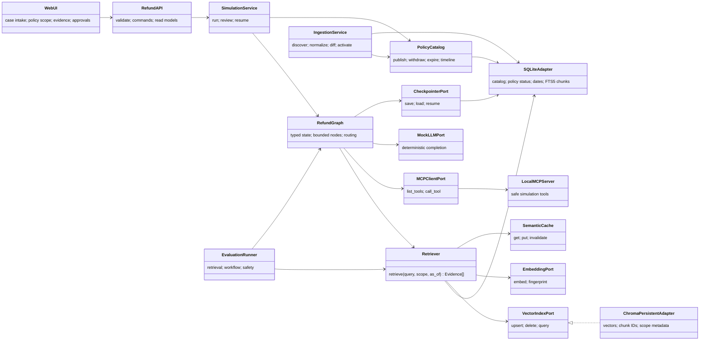
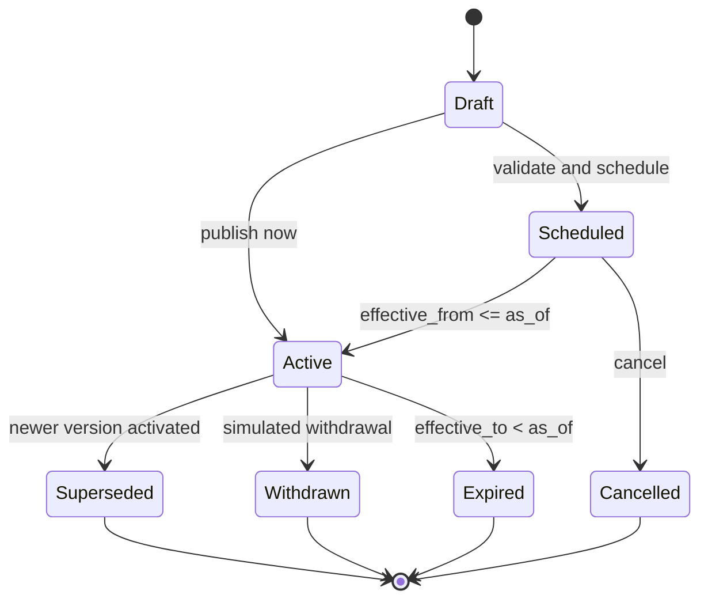
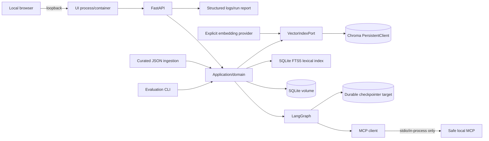

# Low-level design — implementation contract (v0.2)

This design records current implementation separately from planned and undecided behavior. RefundFlow is a local refund-support simulation: it never issues refunds or contacts customers/third parties.

## Boundaries and contracts



No application ports or Chroma adapter exist yet. Ingestion synchronization now loads validated curated JSON, rejects missing source directories and unsafe lifecycle/date states, and atomically reconciles catalog events/current metadata with SQLite FTS chunks in the shared database. It skips unchanged versions, requires a new immutable version for content-hash changes, supersedes replaced versions, withdraws removed files, preserves unrelated chunk IDs, and rolls both projections back on failure. Policy content changes within one version are rejected rather than silently reindexed. There is no ingestion-run/provenance status table, catalog/index rebuild or historic generation rollback, filesystem snapshot lock, or vector/embedding/cache integration yet. See Decision 0015 for the boundary and limitations.

### Source-generation recovery and operator status (decision 0016)
SQLite remains the sole authority. Add append-only ingestion runs/items and a monotonic active-generation pointer; each successful source sync records a complete immutable snapshot manifest (policy/version/content hash and source identity) plus per-item outcome/provenance. Statuses are `running`, `succeeded`, `failed`, and `rolled_back`; item outcomes distinguish `added`, `changed`, `unchanged`, `removed`, and `error`. Only a committed successful run may become active. A failed run retains error summary and never changes the active generation. Rollback is a compensating operation: reapply the selected prior successful manifest to catalog and FTS in one SQLite transaction, append lifecycle events rather than delete history, and record a new successful generation referencing the restored run; do not mutate prior run records. Rebuild reconstructs catalog projections and FTS from the chosen manifest and recorded canonical source bytes/records, validates hashes before commit, and atomically replaces only derived index state. Missing/corrupt source or any validation/write error leaves the previous active generation untouched. Repeated rebuild/rollback of the same snapshot is idempotent. The file source directory is not transactionally locked: capture and hash the complete input manifest before opening the write transaction, then verify it has not changed immediately before commit; mismatch aborts with a failed run and requires retry. This SQLite-only first slice does not synchronize Chroma; any future derived vector adapter must expose lag/error and be rebuildable from the committed manifest, never gate SQLite freshness.

## Data model, migrations, concurrency

```mermaid
erDiagram
  POLICY ||--o{ POLICY_VERSION : versions
  POLICY_VERSION ||--o{ POLICY_EVENT : changes
  POLICY_VERSION ||--o{ CHUNK : indexed_as
  INGESTION_RUN ||--o{ INGESTION_ITEM : processes
  CASE ||--o{ DECISION : proposes
  DECISION ||--o{ DECISION_EVIDENCE : cites
  DECISION ||--o{ APPROVAL : gates
  CASE ||--o{ AUDIT_EVENT : records
  POLICY { text policy_id PK; text owner_department; text source_type; text source_name }
  POLICY_VERSION { text policy_id PK,FK; text version PK; text content_hash; text status; date effective_from; date effective_to; text provenance_json }
  POLICY_EVENT { integer sequence PK; text policy_id; text version; text event_type; text occurred_at; text reason }
  CHUNK { text chunk_id PK; text policy_id FK; text version; text section_id; integer ordinal; text text_hash; text body; text index_config }
  INGESTION_RUN { text run_id PK; text started_at; text status; text config_hash }
  INGESTION_ITEM { text run_id PK,FK; text policy_id PK; text version; text outcome; integer changed_chunks }
  CASE { text case_id PK; text thread_id UK; text created_at; text input_redacted }
  DECISION { text decision_id PK; text case_id FK; text outcome; text rationale; text state; text scope_hash }
  DECISION_EVIDENCE { text decision_id PK,FK; text chunk_id PK; text citation_json }
  APPROVAL { text approval_id PK; text decision_id FK; text actor; text choice; text occurred_at }
  AUDIT_EVENT { integer sequence PK; text trace_id; text subject_type; text subject_id; text event_type; text occurred_at; text payload_redacted }
```

ERD is **planned**, not an existing migration. Actual catalog tables: `policy_versions(policy_id, version, department_id, content_hash, record_json)` with composite PK `(policy_id, version)` and `policy_events(sequence, event_type, policy_id, version, department_id, occurred_at, reason)`. The separate index creates `policy_chunks(chunk_id, policy_id, version, department_id, section_id, text_hash, body, active)` with a scope index and unique `(policy_id, version, section_id, text_hash)`, plus FTS5 `policy_chunks_fts(chunk_id UNINDEXED, body)`. `SQLiteEvidenceRetriever` now integrates this index with catalog current snapshots and returns cited, metadata-bearing evidence after current-version, department, status and explicit-date filtering. No foreign keys, migration framework, case/checkpoint tables or index audit events exist. SQL is parameterized; catalog `current()` means latest insertion, not effective-date winner.

The index currently hashes policy/version/section, whitespace-normalized text and the `chunk-v1` marker into a stable chunk ID. Re-ingesting identical content reuses the active row; changed content retires the prior chunk ID within that complete version. Versions omitted from an ingestion remain available for historical retrieval; an empty snapshot requires explicit `complete_versions` so deletion is not inferred from missing input. A policy version's department is immutable (as in the catalog); ingestion rejects mixed departments in one snapshot and department changes from previously indexed rows. A `section_id` may repeat for multiple distinct chunks; the text hash differentiates them and exact duplicate text is deduplicated, but no ordinal/source order is stored yet. Chunk-row, FTS mutation and retirement are one transaction; injected failure rolls back. `active` means present in the indexed snapshot, not legally effective. FTS5 search uses OR semantics and supports department plus optional policy/version filters. Retired rows are retained but no audit event is emitted. `SQLiteEvidenceRetriever` rechecks catalog version, department, active status and explicit `as_of` dates before returning typed evidence with `policy@version#section` citation keys. It currently returns only the catalog's latest inserted version, even if a different historical version would be effective on `as_of`; multi-version effective precedence/conflict selection is not implemented. Candidate fetch has a bounded per-department window (`20 * top_k`), so filtering many stale candidates can underfill; measure and improve before claiming exhaustive ranking. Planned: parser/chunker versioning beyond v1, ordinal metadata, evented retirement, precedence-aware effective-date selection, bounded candidate pagination, Chroma/vector retrieval, cache, and measured indexes for department/version/status/effective dates, event subject/sequence and ingestion status. Enable SQLite foreign keys per connection and index child keys.[1]

Migrations: ordered immutable SQL files and `schema_migrations(version, checksum, applied_at)`; verify checksum, apply transactionally, test upgrades and backup/restore. SQLite is the selected local catalog and lexical-index store; the migration tool remains undecided, with stdlib as the baseline. SQLite allows multiple readers and one writer; transactions stay short, bounded `SQLITE_BUSY` handling, selective `BEGIN IMMEDIATE` for read-then-write; parsing/embedding/model work never holds write lock.[1] WAL and busy timeout need configuration. Catalog/event/active-index pointer commit atomically; validate sources before transaction and recheck hashes before activation.

## Policy lifecycle and precedence

All state changes take explicit `occurred_at`/`as_of`. Implemented expiry is deterministic, ISO-date based, inclusive through `effective_to`, and idempotent. Withdrawal appends event and updates latest inserted record. Scheduled publish/amendment is absent.



Planned selection filters department/policy scope, active status, `effective_from <= as_of <= effective_to` (null end unbounded). Among versions choose latest activated eligible version, never insertion order; at most one active per policy/as-of. Distinct policies require configurable priority/category. Equal-priority incompatible clauses surface conflicts, never silently lexical tie-break. Explain selected clause/citation and exclusions (department, future, expired, withdrawn, superseded, priority/conflict). Priority/conflict schema undecided. Rollback is compensating event/restoration, never history deletion; restore index generation and cache scope. Current code lacks actor, scheduling, precedence, rollback, index sync.

## Parsing, ingestion, retrieval

Current source is curated synthetic JSON; no network fetch. Validate stable ID, department, version/status/dates, provenance/license and hash. Planned normalization (Unicode NFC, line endings, whitespace preserving headings) records parser/chunker revision. Parser contract `parse(source_ref, media_type) -> NormalizedDocument`, initially JSON/plain text. Docling LangChain loader supports PDF/DOCX/PPTX/HTML and chunk/Markdown export, but is not installed/selected; runtime/model/resource cost requires format need, license/security/compatibility review and offline fixtures.[6]

```mermaid
sequenceDiagram
  participant Caller
  participant Ingest as IngestionService
  participant Files as Curated sources
  participant Parser as Parser/normalizer
  participant DB as SQLite catalog/index
  participant Cache as Scoped semantic cache
  Caller->>Ingest: ingest(scope, as_of, run_id)
  Ingest->>Files: enumerate validated manifests
  Ingest->>DB: read known hashes/versions
  loop added/changed only
    Ingest->>Parser: parse, normalize, chunk
    Parser-->>Ingest: content, provenance, stable IDs
    Ingest->>Ingest: diff IDs and hashes
  end
  Ingest->>DB: transaction: upsert, retire, events, active pointer
  alt failure
    Ingest->>DB: rollback; retain previous generation
    Ingest-->>Caller: safe failed-run result
  else success
    Ingest->>DB: commit
    Ingest->>Cache: invalidate affected scope
    Ingest-->>Caller: counts and freshness
  end
```

The SQLite index now offers a caller-owned transaction reconciliation method so policy catalog and lexical rows can be committed or rolled back together. The existing standalone API remains atomic. Source ingestion is a first end-to-end lexical path; the older direct token-overlap policy lookup still exists. It currently creates one stable section chunk per curated excerpt, not a general parser/chunker pipeline. Ingestion metrics count policy additions/version changes/removals/unchanged snapshots and index processed/reused/retired chunks. It does not expose run records or per-document operator status. No vector retrieval, embeddings, cache, automatic rebuild, multi-version effective precedence, or historical generation rollback exists.

Planned `retrieve(query, Scope, as_of, top_k) -> Evidence[]`: filter before deterministic ranking/ties. Evidence carries chunk/policy/version/department IDs, provenance, section, effective dates, content hash, excerpt, method/score and citation key. Empty remains empty. Decisions pin chunk IDs and policy hashes; freshness check before display and approval/resume; stale evidence triggers reretrieve or stop.

## Cache

No cache currently. Planned semantic key includes canonical query, department/policy/version scope, as-of eligibility, parser/chunker/retriever/ranker/embedding/model config fingerprints. Store evidence references and rehydrate against current status/version/dates. Invalidate affected scopes only, expose hit/miss/stale-rejection reason. Freshness overrides TTL. Prompt cache is provider-dependent concept; mock has none.

## LangGraph, approval, MCP

No graph exists. Planned typed state: case/trace, protected scenario reference, explicit scope/as-of, evidence/citations, bounded assessments, simulated proposal, risk/conflict, approval actor/status, termination/error. Avoid PII in checkpoint/audit. Bounded nodes: validate → retrieve → configured specialists → consolidate/safety → proposal → approval interrupt → validate resume → audit. Deterministic routing, one pass per selected role, bounded transient retries/steps; no open-ended delegation or external endpoints.

Use checkpointer for thread-scoped state and stable thread ID; business records/audit stay in app DB. LangGraph distinguishes checkpoint from cross-thread store.[3] Interrupt needs checkpointer and same thread ID; resume payload is validated, and code before interrupt may replay, so side effects must be idempotent and after validation.[4]

```mermaid
sequenceDiagram
  actor Operator
  participant API
  participant Graph as LangGraph
  participant DB as SQLite/checkpoint/audit
  Operator->>API: submit scenario and scope
  API->>Graph: invoke(input, thread_id)
  Graph->>Graph: validate, retrieve, assess, safety
  Graph->>DB: proposal + evidence/version refs
  Graph-->>API: interrupt(proposal, evidence, reason)
  API-->>Operator: citations and simulated proposal
  Operator->>API: approve/deny + actor + note
  API->>DB: validate pending decision; record intent
  API->>Graph: resume validated choice on same thread
  Graph->>Graph: validate; no external action
  Graph->>DB: append audit outcome
  Graph-->>API: terminal simulated outcome
```

Approval is annotation, not refund permission. Validate pending decision/thread, one-time transition, local actor policy (auth undecided), choice and payload size; idempotency prevents duplicate event. Never hold DB lock while awaiting human. Define crash reconciliation for separate checkpoint/audit writes before release.

No MCP SDK/server/client exists. Graph tools cross MCP client adapter. Provisional local allowlist: `policy.get`, `policy.timeline`, `case.simulate_summary`; bounded JSON schema, typed provenance/trace/errors, no arbitrary SQL/path/URL, refunds or external contact. Read-only resources; chaos mutations via audited app command. MCP defines host/client/server and JSON-RPC data/transport; use local stdio/in-process only, no remote service/credentials.[5] Integration tests use real in-process protocol; SDK selection follows compatibility/license review.

## API and UI

Neither exists. Planned FastAPI/Pydantic schemas, bounded inputs, stable `{code,message,trace_id,details?}` errors, no PII/stack leakage and OpenAPI contract tests. Candidate endpoints: health, departments, policies, timeline, ingestion, case create/read/trace, approval. Mutations idempotent/audited. Auth undecided; no public exposure or arbitrary MCP/model proxy. UI has scope/disclaimer, loading/empty/error states, evidence/version citations, trace, approvals, keyboard/focus/labels/contrast checks. UI calls API only.

## Failure, security, privacy

Invalid source/date/hash rejects without replacing active index. Transient I/O retries bounded; deterministic validation does not. SQLite busy/disk/I/O rolls back and reports trace-linked safe error. Empty/conflicting/stale evidence stops or asks review; no invented citations. MCP retry only idempotent read. Graph/checkpoint crash reconciles command IDs. Invalid/duplicate approval cannot alter terminal result.

Treat scenario/policy text as untrusted data, not instructions. Bound tools/authority/payload; validate inputs/results; configured-root path containment; no URL fetch; parameterized SQL. Future secrets in environment/secret store, never repo/logs. Minimize scenario retention and redact logs; retention/backup policy before production. No refund, contact, remote MCP or public service.

## Observability and evaluation

Propagate trace/run IDs through API, nodes, retrieval, ingestion, MCP, cache, approval and audit. Structured events: timestamp/component/outcome/duration, policy/version/chunk IDs, config/scope hashes, counts, safe error category; omit customer text/secrets. Append-only audit records actor, simulated decision, cited versions, approval. Reports expose freshness, work counts, lifecycle, citations/metrics, cache reasons, graph and safety. Existing observability document is proposal only.

Evaluation uses fixed dates and synthetic fixtures: Recall@k/MRR where labels exist, citation integrity/freshness; ingestion changed/unchanged/retired counts, idempotency/rollback; bounded routing/no external effect, malformed MCP, interrupt/restart/resume/duplicate approval; API/UI, accessibility/security/Docker separately. Mock-LLM metrics are not real-provider performance. Harness not implemented.

## Local deployment and patterns



Planned topology; today only Python modules, JSON policies, SQLite catalog/FTS5 index and pytest runnable. Chroma, Docker/Compose/UI/API/checkpointer/MCP and integrated vector retrieval are not implemented. Chroma is the intended local vector adapter but adoption is blocked until a patched release passes security review; it should then live in an optional dependency extra, use explicit embeddings, and remain rebuildable rather than become a policy source of truth. SQLite remains authoritative for status, provenance and effective dates. Production migration means replacing the SQLite/Chroma adapters behind ports, migrating relational state, rebuilding vectors from canonical chunks, and rerunning retrieval/freshness evaluations; local file formats are not promised to be production-compatible. Production non-root, health, volume, backup, migration, TLS/reverse proxy remain future work. Piper isolated/falls back to text; no model download without size/license review and approval.

Patterns address concrete problems: ports/adapters isolate real replacement boundaries (direct framework coupling is simpler but harms replacement/testing); append-only events plus current projection preserve change history without full event sourcing (current JSON status is mutable); content-addressed chunk IDs preserve unchanged references but require versioned normalization; a rebuildable Chroma index avoids making vector data the policy source of truth; bounded graph/interrupt enables inspectable safe routing instead of open-ended loops; SQLite favors local operation at cost of serialized writes.

## Acceptance and sources

Claim only tested behavior: lifecycle precedence/conflict/rollback; incremental IDs/change/deletion/retry; freshness/citations/cache invalidation; graph checkpoint/restart/interrupt; MCP; API/UI; no external effects. Current verified scope: catalog validation/publication/timeline/withdrawal/expiry, synthetic JSON validation and lexical retrieval.

Official sources consulted 2026-11-16:
[1] [SQLite transactions](https://sqlite.org/lang_transaction.html) — transaction modes, one-writer behavior, busy.
[2] [SQLite foreign keys](https://sqlite.org/foreignkeys.html) — enforcement and child-key indexes.
[3] [LangGraph persistence](https://docs.langchain.com/oss/python/langgraph/persistence) — checkpoint vs cross-thread store.
[4] [LangGraph interrupts](https://docs.langchain.com/oss/python/langgraph/interrupts) — checkpoint/thread/resume behavior.
[5] [MCP architecture](https://modelcontextprotocol.io/docs/2026-07-28/learn/architecture) — host/client/server and JSON-RPC transport.
[6] [LangChain Docling loader](https://python.langchain.com/docs/integrations/document_loaders/docling/) — parsing/export options; dependency not selected.
[7] [Chroma clients](https://docs.trychroma.com/docs/run-chroma/clients) — persistent local client and deployment modes.
[8] [Chroma embedding functions](https://docs.trychroma.com/docs/embeddings/embedding-functions) — explicit embedding functions and default model behavior.
[9] [Chroma collection API](https://docs.trychroma.com/reference/python/collection) — upsert, query, metadata filters and delete.
[10] [Chroma license](https://github.com/chroma-core/chroma/blob/main/LICENSE) — Apache-2.0.
